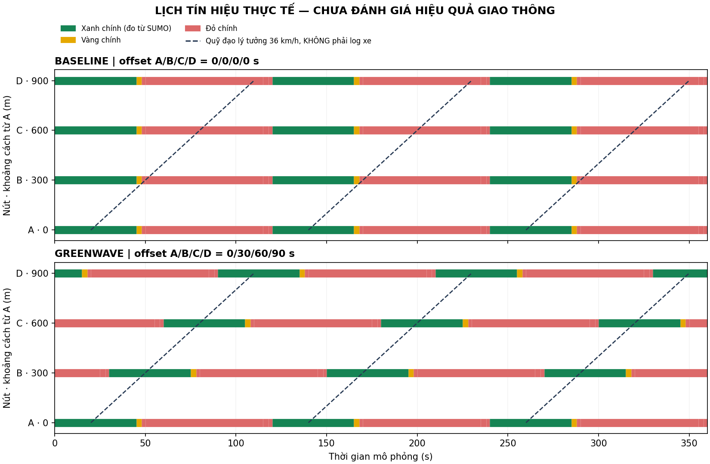

# Kết quả kiểm chứng Giai đoạn 3

## Phạm vi và nguồn nền

Ngày 23/10/2026. Nền là bản GĐ2 đã bàn giao và chạy trên Windows theo xác nhận người dùng. GitHub tại commit 5fdcd65a2b53c892c2e3d7f154b4ff6e536e7822 chưa có các file GĐ2; không dùng nó làm bằng chứng đã đồng bộ local/remote.

Môi trường thực sự kiểm thử GĐ3: Python 3.12, Linux, Eclipse SUMO 1.28.0. Phiên bản đầy đủ, hash đầu vào và hash log nằm trong [verification.json](stage3-evidence/verification.json). Không tự tạo số liệu hiệu quả hoặc gán giả định thành yêu cầu giảng viên.

## Các kiểm tra đã chạy

| Hạng mục | Kết quả |
| --- | --- |
| Công thức, đơn vị, modulo | Ví dụ tính tay [0,30,60,90], khoảng cách không đều và thời gian vượt chu kỳ đều đúng |
| Đầu vào | Từ chối tốc độ 0/NaN/vô cực/bool, khoảng cách 0, mốc ngoài lưới 1 giây |
| Đối chiếu mạng | 4 nút, trục A→D, tọa độ cách 300 m, tốc độ thiết kế 10 m/s; sai cấu hình/mạng bị phát hiện |
| XML và cấu hình | Cả hai chạy với --xml-validation always, không lỗi/cảnh báo |
| Đối chứng công bằng về cấu hình | Mạng/luồng xe/thời gian/seed giống nhau; XML cấu hình chỉ đổi tham chiếu đèn |
| Lịch cố định | Cùng 6 pha 45/3/2/65/3/2 s, chu kỳ 120 s |
| Tránh xanh xung đột | Đối chiếu từng pha với ma trận foes trong mạng |
| Tín hiệu thực | 7200 bản ghi/lần chạy: 4 nút × 1800 bước, đối chiếu mọi trạng thái, thứ tự pha, mốc bật xanh |
| Khác biệt cơ chế | Baseline 0/0/0/0; Green Wave 0/30/60/90 s; log thực khác nhau |
| Xe đi hết tuyến | 85/85 xe hoàn tất ở mỗi phương án; 30 xe ưu tiên đi đúng W_A A_B B_C C_D D_E |
| Kiểm tra an toàn bài mẫu | Không có va chạm/teleport; không còn xe đang chạy hoặc chờ phát tại cuối mô phỏng |
| Tái lập | Mỗi phương án chạy 2 lần: hash lịch và hash dấu vết hành trình trùng nhau trong cùng phương án |
| Bộ test Python | 20/20 đạt, gồm 10 test cũ và 10 test GĐ3; xem tests.txt |
| Giữ chức năng cũ | Không thay file GĐ2; sample vẫn được bộ test cũ kiểm chứng |
| Tích hợp an toàn | Thử xung đột: dừng trước khi thêm file; thử cài hai lần: lần hai không ghi lại; SHA-256 file nền giữ nguyên |
| Bản tích hợp sạch | Ghép nền gốc + GĐ2 + GĐ3 vào đường dẫn có khoảng trắng, 20/20 test đạt |
| Script mở dòng lệnh | run_plan.py --plan baseline --cli và --plan greenwave --cli đều kết thúc thành công |

Tổng trong lệnh verify là 4 lượt chạy, 28.800 bản ghi tín hiệu được đối chiếu; CSV kèm theo lưu lần đầu mỗi phương án, tổng 14.400 bản ghi. Không coi số lượt test lặp là các mẫu thực nghiệm độc lập.

## Mốc bật xanh được đo

| Nút | Baseline (s) | Green Wave (s) |
| --- | --- | --- |
| A | 0,120,240 | 0,120,240 |
| B | 0,120,240 | 30,150,270 |
| C | 0,120,240 | 60,180,300 |
| D | 0,120,240 | 90,210,330 |

Trạng thái ban đầu ở D thuộc một cửa sổ xanh bắt đầu trước t=0; không tính nhầm thành sự kiện bật xanh mới. Hai phương án giữ nguyên độ dài pha, chỉ dịch mốc chu kỳ.

Sơ đồ hiển thị 0–360 s. Đường nét đứt là ví dụ quỹ đạo lý tưởng ở tốc độ thiết kế, không phải xe lấy từ log.

## Chưa kiểm thử và chưa kết luận

- Chưa mở GUI GĐ3 hoặc chạy PowerShell GĐ3 trên máy Windows của người dùng; mới kiểm thử tự động trên Linux.
- Chưa kiểm thử phiên bản SUMO khác 1.28.0.
- Chưa làm ba mức lưu lượng, phân tích thống kê, bandwidth thực nghiệm, mô hình rẽ/người đi bộ hoặc tối ưu hai chiều.
- Chưa hiệu chỉnh thời gian đi theo quỹ đạo, hàng chờ và tốc độ thực; offset là khởi tạo lý tưởng theo khoảng tâm nút.
- Seed 11 và vType sigma=0 của mẫu hiện có phù hợp kiểm tra tái lập, chưa đại diện nhiều điều kiện ngẫu nhiên.
- 85 xe hoàn tất ở hai phương án chỉ chứng minh mô hình chạy thông suốt; không kết luận hiệu quả tương đương hoặc Green Wave tốt hơn.

## Chạy lại

Xem [hướng dẫn Windows](stage3-windows.md). Giữ log cùng hash đầu vào; sau thay đổi config/mạng phải build và verify lại. Hash của net.xml có thể đổi khi tái sinh do phần chú thích NETCONVERT; khi đó dùng minh chứng mới từ cùng lượt chạy, không gán log cũ cho đầu vào mới.
